# Hi, I'm Vahid 👋

### IT Infrastructure • Network Engineering • Systems & Software

Building dependable infrastructure, practical internal tools, and secure, maintainable systems.

---

## About Me

I'm an IT professional focused on **enterprise networking, systems administration, infrastructure security, and purpose-built software**.

I enjoy connecting the dots between operations and development: solving real infrastructure problems, automating repetitive work, and creating tools that make IT services easier to manage.

- **Networking:** Routing, switching, VLANs, VPNs, firewall policies, and network troubleshooting
- **Systems:** Windows Server, Active Directory, IIS, Linux, and service operations
- **Development:** C#, ASP.NET Core, SQL Server, PowerShell, and practical web applications
- **Infrastructure:** Docker, monitoring, backups, configuration management, and automation
- **Exploring:** On-premises AI, video analytics, and smarter operational dashboards

## Tech Stack

## GitHub Stats

> GitHub cards are generated from available GitHub data. Private repositories and contributions may not be included in public statistics.

## Selected Work & Interests

### IT Asset Management & Operational Tools
Designing practical workflows for equipment inventory, configuration archives, maintenance tracking, reporting, and operational dashboards.

### Network Infrastructure & Secure Connectivity
Working with segmented networks, MikroTik routing and firewall policies, L2TP/IPsec VPNs, connectivity diagnostics, and secure access to internal services.

### Systems Administration & Automation
Maintaining Windows and Linux environments, deploying applications on IIS, working with SQL Server, and streamlining repeatable tasks with PowerShell and Docker.

### Monitoring & On-Premises AI
Exploring IP camera interoperability, video monitoring, and local AI services for privacy-conscious operational use cases.

## Engineering Principles

- **Security first:** Least privilege, controlled access, and defense in depth
- **Reliability:** Backups, observability, and reversible changes
- **Maintainability:** Clear documentation and predictable deployments
- **Practical impact:** Tools that solve real problems for real teams

---

### Keep learning. Keep building. Keep improving.

*Thanks for visiting my profile!*

